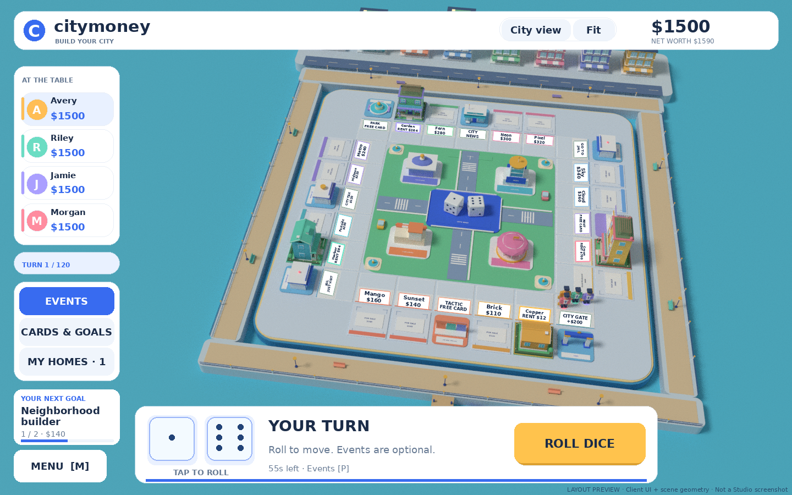
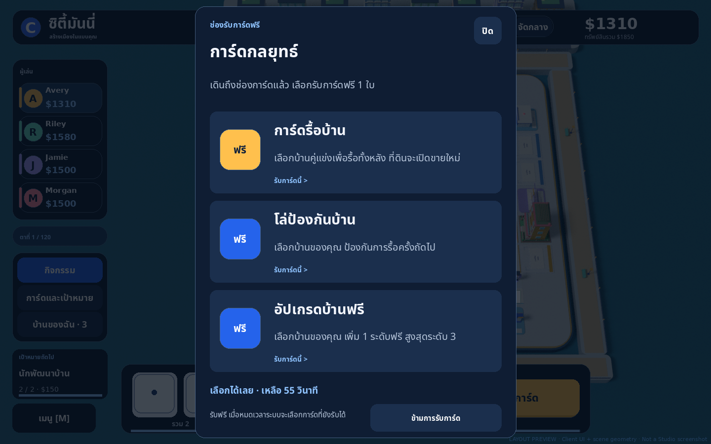
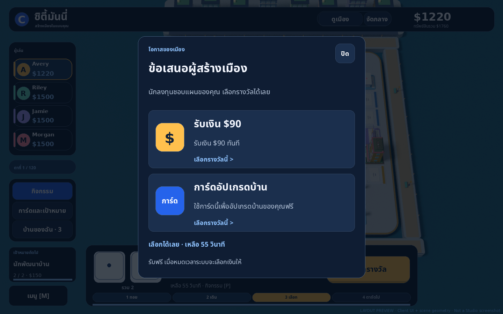
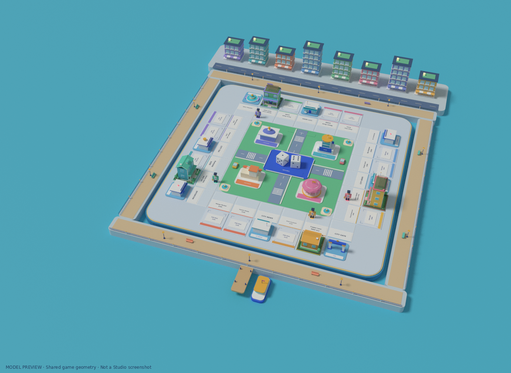
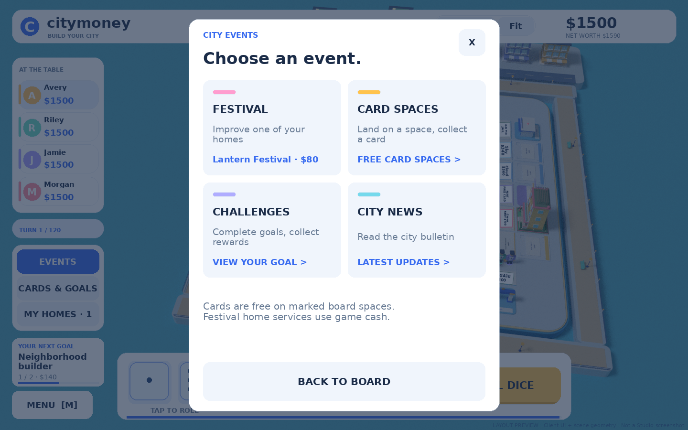
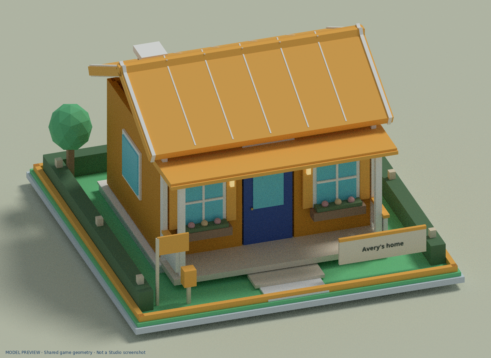
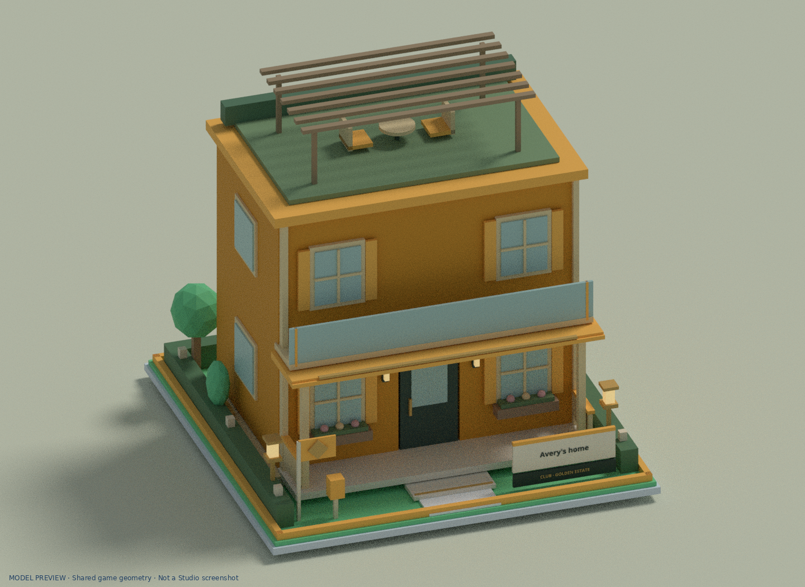

# Citymoney · Build Your City

**ซิตี้มันนี่ 1.2 — เกมภาษาไทยและมุมมองที่อ่านง่ายขึ้น**

เมนู การ์ด เป้าหมาย ข่าว ชื่อที่ดิน และรายละเอียดบ้านเป็นภาษาไทย กระดานวางตรง มุมมองด้านบน 64 องศา ลดความเพี้ยนของช่องด้านหน้าและด้านหลัง กล้องนิ่งระหว่างเล่น ชื่อย่อกับราคาอยู่ในช่อง และแตะดูรายละเอียดได้

เปิด **Citymoney/build/Citymoney.rbxlx** ใน Roblox Studio แล้วกด **Play → เริ่มเล่น → 2 คน / 4 คน → ฝึกกับบอต** อ่าน [คู่มือภาษาไทย](START-HERE-TH.txt) และ [วิธีเผยแพร่และสร้างพาส](PUBLISH-FIRST.md)



A bright, stylized Roblox property board game with colorful houses, a rounded city board, interactive 3D dice, automatic turn handoffs, and four playable city destinations. Play through **2- or 4-player online queues**, invite friends, choose your property's rent, and decide which rival house to demolish.

**Inset spaces and visible residents:** every name and price stays inside its board space. Wider square spaces separate a blue walking lane from the deed panel. An aligned 64° overhead angle shows larger full-body pawns, with owner-colored rings and outlines. Both dice settle and show their result for 0.4 seconds before the first step.

**Dedicated card spaces:** land on **Tactic Cards** to collect demolition, shield or renovation, or **Rent Cards** to collect rent demand or rent boost. Choose one free card after your pawn arrives. All 16 home plots remain. Tactical cards are collected through gameplay; the card market has been removed.

The **Cosmetic Shop** keeps server-confirmed Robux checkout for visual collections only. Reserved matches validate every arriving player, and eliminated pawns leave the route.

Includes an optional **Waterfront Club cosmetic game pass** with three luxury collections, a 3D showroom, styled dice, player auras, walking trails, saved preferences, and reduced motion. **[Publishing and pass setup guide](docs/PUBLISHING.md)**.

**[Download the Studio game ZIP](https://github.com/evaluegame/Citymoney/raw/refs/heads/main/Citymoney-Publish-Ready.zip)** · **[Studio place file](https://github.com/evaluegame/Citymoney/blob/main/Citymoney-Waterfront.rbxlx)**

For the final bundle, start with **[PUBLISH-FIRST.md](PUBLISH-FIRST.md)**. The release includes a **[test report](docs/RELEASE-CHECKS.md)** and **[copy-ready Roblox listing](docs/ROBLOX-LISTING.txt)**.

The download files are at the repository root. On a GitHub file page, use **Download raw file** (the download-arrow button). The ZIP includes a ready-to-open place, source, and instructions.


*Layout preview: actual client GUI positions over the shared scene geometry and generated resident model, with example purchases. This is an offline review image, not a Roblox Studio screenshot. Personal Roblox avatars, native rendering and live services still need Studio/app playtests.*

[Settled dice before movement](docs/Dice-result-preview.png) · [Movement with the fixed camera](docs/Walking-screen-preview.png) · [Phone view](docs/Walking-phone-preview.png)

## Collect cards on their own board spaces



**Tactic Cards** and **Rent Cards** are permanent, clearly marked plots on the route, with physical card displays. Landing opens a free collection dialog after the dice and movement finish. Choose one listed card, or continue without collecting. A full card type is disabled; another available choice can still be collected. On timeout, the server selects an available card, or continues if all choices are full. Each landing can be claimed once. Cards do not cost game cash or Robux, and buying a home does not grant a card. The Card Spaces screen explains where to collect; it cannot sell cards or grant them remotely.

[Phone card-space preview](docs/Card-space-phone-preview.png) · [Rent Cards preview](docs/Rent-card-space-preview.png)

## Dice finish before moving

The physical dice complete their tumble and settle on their final values. The result stays visible for **0.4 seconds**, then the resident moves in separate steps. HUD dice use the same server timeline and stop changing before movement. If the physical dice finish late, movement, arrival, buying/reward deadlines and the automatic handoff shift together; the decision clock still starts after arrival.

The board camera stays at the same position through rolls, walking, purchases, upgrades and property inspection. Automatic follow, zoom buttons, mouse-wheel zoom and the board close-up control have been removed. **City view / Board view** explicitly switch between two views; **จัดกลาง** restores Board view. Window resizing still fits the board to the available screen. Smaller map names and the city title keep the view clean.

Real avatars replace the colored fallback residents only after the body and outfit finish loading. Board avatars use a 1.8× scale; home visits restore normal size, and returning restores the board scale. R6 standing height includes its legs, keeping the whole body above the board; R15 uses its hip height. Both remain visible after a first-person visit. Idle residents face the board viewer, and moving residents face their route. Small name/seat tags sit above their heads, and player-colored outlines remain visible behind scenery. Labels clear the body from head to feet while it passes. The city includes **eight public downtown buildings**, a city gateway, news kiosks, a bank, police offices, a park fountain, waterfront boardwalks, lamps, benches and a ferry. Public services occupy city-service parcels; unowned player plots remain empty until bought. **ดูเมือง** shows the whole waterfront.

## Three easy steps

1. กด **เริ่มเล่น** เลือก **2 คน / 4 คน** แล้วกด **เล่นออนไลน์** หรือ **ฝึกกับบอต**
2. แตะลูกเต๋าหรือ **ทอยลูกเต๋า** ถึงที่ดินว่างให้เลือกขนาดบ้านแล้วซื้อหรือ **ข้าม** ถึงช่องการ์ดให้เลือกใบฟรีหรือ **ข้ามการรับการ์ด**
3. ทำรายการเสร็จแล้วเปลี่ยนตาอัตโนมัติใน 4 วินาที ใช้ปุ่ม **กิจกรรม**, **การ์ดและเป้าหมาย**, **บ้านของฉัน** เพื่อจัดการก่อนทอย

[Phone layout preview](docs/Phone-screen-preview.png) · [Play menu preview](docs/Start-menu-preview.png) · [คู่มือภาษาไทย](START-HERE-TH.txt)

## More decisions and clearer rewards

Your next goal stays visible on the main screen with a progress bar and its cash reward. When it is ready, tap the goal card on your turn to claim it directly. A short celebration shows what you earned and moves on to the next goal. Card rewards use available hand space; a completely full hand still receives the cash reward.

Every **second City News visit for each resident** opens a **City Opportunity**: choose guaranteed cash or a specific tactical card. Five offers rotate through renovation, protection, rent demands, rent boosts and demolition permits. Each choice shows its effect, costs nothing, and grants the selected reward once. A full card type is disabled; cash remains available. The card goes into your hand and is played separately. After 55 seconds, an unanswered choice takes cash automatically. Bots choose useful cards or cash. Player colors and paid cosmetics do not affect the offers.



*Offline client-layout and scene-geometry preview, not a Studio screenshot.*

Tokens move **one space at a time**, taking **0.38 seconds per space**: a gentle 0.25-second move followed by a stationary 0.13-second pause at its exact center. A small lift replaces the large continuous hops. News cards that move a token elsewhere visit the rolled space first, then move to the event destination. Dice totals stay visible in the HUD, leaving the walking route clear. Landings, rent demands, protected houses, upgrades and goal rewards have short, readable result cards. The four-second handoff and full purchase/opportunity decision clocks start after the dice and route presentation; early finish, buy/skip and reward requests wait for arrival. Reduced motion keeps the information and suppresses animation effects.

[Goal reward preview](docs/Goal-reward-preview.png)

## A clearer city and play screen

The game opens in **ดูกระดาน** at an aligned 64° angle with no yaw and a 28° field of view, showing resident bodies and building fronts. The camera fits the complete route and maximum building heights into the free HUD area, including window resizing and device safe areas. Every space is 18.8 × 18.8 studs, with a separate walking lane and an inset name/price band. Clickable labels follow their tile’s orientation; all four corners stay inside their projected physical plate, including the side rows. Their text scales to the available space, and owner-colored borders distinguish rent from sale prices. Tapping opens the full name, owner, level and rent in a larger property card. Physical floor lettering shows current rent after upgrades and boosts, and restores the land price after a sale or demolition. **ดูเมือง** shows the entire waterfront; **ดูกระดาน** returns. **จัดกลาง** restores the playable board. The Studio editor opens at the same angle. Purchases, upgrades and property cards keep the camera fixed.

The persistent interface has a wallet header, a slim color-coded roster, one **เมนู [M]** button, direct **EVENTS / CARDS & GOALS / MY HOMES** shortcuts, and a turn dock with larger beveled pip dice and one large gold action. The dock explains the next step and shows the rolled total. Phone layouts enlarge the shortcuts, dice, camera controls and property panels. Real players use Roblox avatar thumbnails with a colored initial while loading; bots use initials. The menu opens **Play Together**, **การ์ดและเป้าหมาย**, **City Events**, **Your Properties**, **Cosmetic Shop**, and **How to Play**. Day/night lighting is also in the menu. Buttons respond to hover/press, cash changes float beside the wallet, and purchases/upgrades reveal the home with a short owner-colored celebration. Reduced motion disables movement effects.



*Model preview of the shared scene geometry, including the public downtown, boardwalk, ferry and generated residents. The card-space hall has striped awnings and a clock tower; the festival has a domed stage, the challenge hall a trophy, and City News a broadcast tower.*

## Dice and automatic turns

The physical dice are about 60% larger, with rounded corners and flat navy pips. Their tumble keeps every piece above the felt. During your roll phase, click/tap **either HUD die**, the **3D dice**, or their central **tray**, or press **R**. Everyone sees the same server-selected values. The dice tumble, bounce, and settle with the exact rolled faces on top before the avatar moves. Reduced motion settles the dice immediately. Dice skins remain cosmetic.

After the dice and movement finish and the landing, purchase, opportunity, or pass is resolved, the turn hands off **automatically after four seconds**. The next resident gets a fresh roll phase. **Next player / Space** can hand off sooner after arrival. An unresolved purchase or opportunity keeps its full **55-second decision clock** after movement; a completed turn does not wait for that clock to expire. Use cards, the city plaza, and property management before rolling so you have time to make choices. Browsing menus or changing cosmetics does not postpone handoff.

## The interactive city plaza

The city center has four colorful, clickable destinations. Two additional marked route plots, Tactic Cards and Rent Cards, give free card choices when landed on. Click the direct **กิจกรรม** shortcut, press **P**, click a station, or choose **เมนู → กิจกรรมเมือง**. The overview presents four large event cards; precise clicks on small buildings are optional:



*Offline client-layout and geometry preview; not a Studio screenshot.*

| Destination | What it does |
| --- | --- |
| Card Spaces | See the free collection rules and your inventory. Land on Tactic Cards or Rent Cards to choose a card; the menu does not grant or sell cards. |
| City Festival | Choose one of your homes for the current rotating offer: Lantern Festival gives a two-payment rent boost for $80; Design Fair adds one building level for $110; Neighborhood Watch adds a demolition shield for $60. |
| Challenge Hall | Open your challenge progress, claim completed goals, or choose a new goal. |
| City News | See the active festival and recent city bulletin. |

Festivals rotate every **eight total turns**. The festival screen shows the current offer, price, remaining turns, and eligible homes. One eligible home is selected for you; with multiple eligible homes, choose the target yourself. The confirmation shows the fee and remaining cash, then returns you to the board after a successful purchase. Use **one festival home service per turn, before rolling**. Free card-space collection does not consume that allowance. Playing a tactical card remains a separate allowance. Existing shields/boosts and fully upgraded homes cannot be purchased again wastefully. Failed, stale, unaffordable, or invalid requests spend nothing. Bots use eligible festivals and still improve their homes. All plaza prices use **game cash**, never Robux.

## Open in Roblox Studio

1. Install [Roblox Studio](https://create.roblox.com/) on Windows or macOS and sign in.
2. Download and extract **Citymoney-Waterfront.zip**.
3. Choose **File → Open from File** (Ctrl+O / Cmd+O) and open **Citymoney/build/Citymoney.rbxlx**.
4. Press **Play (F5)** → **เริ่มเล่น** → **2 คน / 4 คน** → **ฝึกกับบอต**. Optional bot and demolition settings are under **ตั้งค่า**.

The neighborhood is visible in the editor; menus appear during Play. The place contains its models and scripts. No paid assets, API keys, plugins, or HTTP access are needed to play it.

## Play online and invite friends

1. Open the updated place and use **File → Publish** (called **Publish to Roblox** in some Studio versions) in your account.
2. In Creator Dashboard, make the experience available to your intended players. A **12-player server capacity** allows several parties to wait in the public lobby. Each reserved match admits exactly **2 or 4 matched humans**.
3. Join the published experience using the Roblox app. Open **เมนู → เล่นกับเพื่อน**, choose a size and optional color, then click **เล่นออนไลน์**.
4. To play together, click **ชวนเพื่อน** before starting the search. A friend accepting that invitation is brought to your public server and joins your party. Guests click **ฉันพร้อมแล้ว**. The party leader queues everyone together.
5. Parties contain up to four people and are never split: two pairs can fill a four-player match, or three friends can wait for one solo player. Online queues never fill seats with bots.

Every match assigns distinct player colors. If separate parties chose the same color, matching gives the later resident an unused color. Roofs, lot borders, flags, mailboxes, avatar rings, and HUD labels use those match colors; house signs also show the owner's name.

Use **ยกเลิกค้นหา** while searching or **ออกจากกลุ่ม** to form a new solo party. Once a match is connecting, wait for the teleport. In an online match, **กลับห้องรอ / ออกจากเกม** returns you to a public server; leaving an ongoing match forfeits your deeds. Invite your friends again from the lobby for another party.

Matching uses Roblox **MemoryStoreService** and **TeleportService** to create a reserved server in the same place. Access codes stay on the server. The destination validates each player’s ticket and roster before marking them admitted, then waits for the matched players. Presence alone cannot start the match. Failed teleports retry; an incomplete arrival times out after 60 seconds and returns arrivals to a public lobby.

**Live queueing, invitations, and teleports require a published experience and a Roblox app playtest.** Studio uses a local queue without live teleports. In **Server & Clients**, launch 2 or 4 clients, choose the same queue size on each, and join the queue on each client. The table starts automatically when enough players are available. Practice is a separate button and can fill empty seats with bots.

## Houses, upgrades, and rent options



*A geometry preview of a purchased cottage.*

Unowned properties are empty lots with district accents and a price plaque. Houses appear only after a purchase. Land on one and choose **Cottage (L0), Townhouse (L1), Garden villa (L2), or Grand villa (L3)**. The larger selector shows a 3D preview, four readable level cards, total price, rent, affordability, and remaining cash. Buying immediately builds your furnished home, porch, mailbox, garden, owner sign, and player color. Wider facades, shutters, porch rails, dormers and level-specific roof details give the levels distinct silhouettes. Only an owned home permits a walk-through.

Purchase price is `land price + selected level × build cost`. Later, select your home during your turn and open **Upgrade options**. Choose any higher level and pay `(target level − current level) × build cost`. You do not need a district pair to upgrade. Houses gain floors, stairs, bedrooms, balconies, or rooftop gardens as their level rises.

Select your property → **Rent options** to buy a permanent multiplier for its future rent payments:

| Rent tier | Multiplier | Fee from the original 1× tier |
| --- | --- | --- |
| Standard | 1× | Included |
| Improved | 1.5× | 2 × build cost |
| Premium | 2× | 4 × build cost |
| Maximum | 3× | 6 × build cost |

Moving between paid tiers charges only the added tier steps: `steps added × 2 × build cost`. The menu shows the fee, resulting rent, and balance before confirmation. The house keeps its building level. Lower/current tiers cannot be purchased again. A physical sign displays the new rate, which continues until the property is sold or destroyed. All payments use in-game cash, never Robux.

For example, Copper Lane costs $90 for land and $60 per building level. A Townhouse costs $150 and earns $36 base rent. Raising its rent from 1× to 1.5× costs $120 and makes future rent $54. Upgrading that Townhouse to Grand villa later costs $120 for two added levels; its paid rent multiplier remains in place.

## Cards, events, and challenges

Open **การ์ดและเป้าหมาย** to select a card, its property, and an opponent where needed. You start with one of each type and can hold up to **three of each type**. Hands are private. Play **one tactical card per turn**, alongside normal rolls, purchases, upgrades, and rent improvements.

| Card | Chosen target and effect |
| --- | --- |
| Demolition permit | Choose an opponent's house. Destroy the entire home and return its lot to the city, clearing building levels, paid rent tiers, shield, and boosts. The former owner receives no refund. |
| Property shield | Choose your home. Block its next demolition attempt; both the attacking permit and shield are consumed. |
| Renovation grant | Choose your home. Add one building level free, up to L3. |
| Rent boost | Choose your property. Add 50% to its rent for the next two paid collections. |
| Rent demand | Choose your property and a living opponent. Collect twice its current rent immediately, capped at $350. This also counts as a collection for a temporary boost. |

Online games always use full-house demolition. Practice offers an optional one-level attack rule; under that rule, attacking an L0 cottage still returns the lot to the city. Signs mark protected homes and rental effects. Destroying a visited home returns its owner to the board.

The remaining **City News** space retains **20 automatic events**, interleaved with the five interactive opportunity choices on every second visit: cash gains/losses, card grants, extra draws, maintenance based on homes or levels, home dividends, a community street fair, and movement events. Passing City Gate and resting in Central Park also award cards, subject to the hand cap.

Seven rotating challenges reward collecting homes, adding building levels, earning rent, passing City Gate, drawing City News, playing cards, and completing districts. Watch the main-screen **goal card** or **การ์ดและเป้าหมาย**, then claim the cash reward and a random card during your turn. Tap a ready goal card to claim directly. Random card rewards choose a type with remaining capacity; if the entire hand is full, the cash reward is still paid and the UI shows that the hand is full. Claim one goal per turn; pay **$50** to change your goal once per turn. Rewards range from $120 to $180. Losing property can invalidate an unclaimed ownership goal. Bots also play cards and claim goals.

## Controls

| Action | Control |
| --- | --- |
| Main menu | **เมนู [M]** or **M** |
| Goal progress / reward | Main-screen goal card; tap to view the goal, or to claim a ready reward on your turn |
| City Opportunity | Choose cash or a card in the reward window; **เลือกรางวัล** reopens it if closed |
| Matchmaking, party, color, practice | **เมนู → เล่นกับเพื่อน**; **เริ่มเล่น** in the lobby |
| Cards, targets, challenges | **การ์ดและเป้าหมาย** shortcut or **เมนู → การ์ดและเป้าหมาย**; the shortcut says **รับรางวัล** when one is ready |
| Roll | Click/tap a HUD die, 3D die, or dice tray; bottom action button or **R** also works |
| Buy / skip / finish early | Bottom action button; **ข้าม** leaves the lot empty; **Space** performs the current action. Resolved turns advance automatically |
| Collect a free card | Land on Tactic Cards / Rent Cards, then choose a card; **รับการ์ด** reopens the dialog |
| City plaza | **กิจกรรม** shortcut, a station, **P**, or **เมนู → กิจกรรมเมือง** |
| Inspect a property | Click/tap its plot or house, **บ้านของฉัน**, or **เมนู → ที่ดินของฉัน** |
| Upgrade / set rent | Select your home during your turn → **อัปเกรด / ตั้งค่าเช่า** |
| Repaint / sell | Property card during your turn; repainting is free, sales ask for confirmation |
| Visit your home | Property card → **เดินชมบ้าน**, including during another player's turn |
| Walk / door / return | Roblox walking controls; **E** operates your door; **B** or **กลับกระดาน** returns |
| Camera | **ดูเมือง / ดูกระดาน / จัดกลาง**; fixed during play |
| Lighting | **กลางวัน / กลางคืน** in the main menu |

Visits do not change your game position, cash, or turn. The match continues while you explore. Rolling/ending your turn returns you to the board. Selling or losing a visited home returns you; upgrades/repainting move you safely onto its front path.

## Waterfront Club cosmetics



*A render of the actual Golden Estate geometry. The showroom previews every collection before purchase.*

Open **MENU → Cosmetic Shop**. Preview **Golden Estate**, **Aurora Residence**, and **Rose Conservatory**, then equip a collection you own. A verified in-game purchase automatically equips the previewed collection. The shop shows the actual Roblox price in **R$**, uses a native checkout, and includes larger touch controls. Each adds coordinated metal trim, marble foundations, garden lanterns, planters, ornaments, a Club plaque, dice colors, and a player aura with a walking trail. Your player-colored roof, borders, flag, and owner sign stay visible. Changing styles also updates existing houses and their 3D property previews.

One **permanent cosmetic game pass** unlocks all three collections. City Original is free. The pass adds appearance only: no extra game cash, cards, rent, turn time, or dice advantages. It is separate from a Roblox Premium subscription. Roblox handles payment and supplies the price; the server verifies pass ownership on join and after purchases. **Check ownership** retries verification, including passes bought outside the game. Only the active collection and effects preference are saved in DataStore; ownership always comes from Roblox. Selections are carried through matchmaking teleports and validated again at the destination.

Only server snapshots confirm a checkout result. Cancelling keeps premium styles locked. Temporary price failures offer **Retry Robux price**; a delayed purchase offers **Verify my purchase** instead of another checkout. The server retries ownership checks and ignores stale responses. A purchase grants appearance only after Roblox confirms ownership; no fake Robux wallet or custom payment page is used.

[Robux shop preview](docs/Robux-shop-preview.png) · [Phone shop preview](docs/Robux-shop-phone-preview.png). These are offline layout/geometry previews using an example R$149 test price; they are not Studio screenshots or an enabled live sale.

**Creator setup is required to sell the pass:** create it under this game's **Monetization → Passes**, put it on sale, and replace `clubPassId = 0` in **ReplicatedStorage → Citymoney → Config** with its numeric asset ID. Republish the place. Until then, the live showroom allows previews and shows **Club pass coming soon**; it cannot charge Robux. See the [full guide](docs/PUBLISHING.md). A ready-to-upload **512×512 PNG** icon is included at `docs/Club-pass-icon.png`.

In Studio, all collections can be equipped for a clearly labeled **test-session preview**; it makes no purchases or permanent unlocks and needs no DataStore/API-access setting. In a published game, only verified pass owners can equip paid collections. **Reduced motion** stops the rotating showroom, dice animation, button movement, cash movement, house reveal effects, victory confetti, and your walking trail. Cosmetic menus do not pause the turn timer.

## Core rules

Start with **$1,500**, roll two six-sided dice, and collect **$200** for passing or landing on City Gate. Doubles do not grant another turn. Own both deeds in a district to double their **L0 base rent**. L1/L2/L3 earn **3× / 6× / 10×** base rent before paid tiers and boosts. City Tax costs $120. Detention skips your next move; merely visiting is harmless.

Rolls allow **55 seconds**. Purchases and City Opportunities receive **55 seconds after movement**. At expiry, the server rolls, declines the property, or chooses opportunity cash. Resolved turns hand off **four seconds after arrival/resolution**. Opening menus, visiting, playing cards, claiming goals, and improving properties do not extend the current deadline. Server checks enforce ownership, targets, funds, inventory, and turn/phase restrictions. Stale and repeated purchases cannot double-charge.

Selling returns half the land, building, and paid rental investment. Cash shortfalls automatically sell deeds in board order; insolvency eliminates a resident. Sold, demolished, abandoned, and repossessed player homes are removed and leave empty lots for sale. A departing resident's deeds return to the city. Eliminated and departed pawns are removed from the route; human spectators return to normal size on the boardwalk. Temporary boosts and shields add no resale value.

The last resident standing wins. At **120 total turns**, the surviving resident with the highest cash plus full property/building/rental investment wins; ties go to the earlier seat. Progress belongs to the current match. Persistent profiles, trading, and auctions are not included.

## Development and verification

Use the existing checkout; cloud tasks do not require a Git worktree.

```bash
cd /workspace/Citymoney
python3 scripts/setup.py
bash scripts/test.sh
bash scripts/build.sh
```

The Linux x86_64 bootstrap installs **Rojo 7.7.1** and **Luau 0.727** into ignored `.tools/` from official releases with verified publisher SHA-256 digests. `build.sh` creates **build/Citymoney.rbxlx** and **build/Citymoney-Studio.zip**. Root download files are release copies refreshed separately; ordinary builds leave them alone.

For source editing alongside Studio, use `rojo serve default.project.json --address 127.0.0.1 --port 34872` and the [official Rojo Studio plugin](https://rojo.space/docs/v7/getting-started/installation/). A source-only build creates the scene at runtime. The packaged place also includes an editor preview.

| Source | Purpose |
| --- | --- |
| `Architecture`, `Board`, `CityArt`, `CityDistricts`, `Scene` | Homes, rounded city geometry, destination buildings, Roblox scene adapter |
| `Presentation`, `Layout`, `client/CommandMenu`, `client/HoverCard`, `client/Motion` | Shared theme, responsive HUD, navigation, property previews and feedback |
| `Engine`, `PropertyPlans`, `Config` | Authoritative economy, turns, home/rental quotes, settings |
| `Tactics` | Cards, targets, challenges, bots' tactical choices |
| `BoardCamera`, `client/BoardView`, `client/TileLabels` | Screen-safe board/city camera fitting and perspective-contained interactive deed labels |
| `Actors`, `CityScenery` | Resident models/poses and the public waterfront |
| `Journey`, `TurnFlow`, `server/DiceWorld` | Settled-dice barrier, result pause, movement and decision-clock alignment |
| `Dice`, `Journey`, `server/DiceWorld`, `TurnFlow` | Exact-result dice, shared movement timing, arrival guards and automatic handoff |
| `Opportunities`, `client/CityOffer` | Guaranteed cash/card choices, card caps, replay protection, timeout and bot decisions |
| `client/GoalDisplay`, `client/MatchFeedback` | Visible goal progress, direct claims, staged result cards and reward effects |
| `Plaza`, `client/CityPlaza` | Festival home services, free-card-space guidance and interactive plaza menus |
| `Cosmetics`, `CosmeticProfiles`, `server/ClubService`, `client/Boutique` | Cosmetic catalogue, verified ownership, saved appearance, Roblox checkout, 3D showroom |
| `Lobby`, `Parties`, `QueuePlanner`, `MatchProtocol` | Parties, exact-size packing, colors, atomic reservations and recovery |
| `server/Matchmaker` | MemoryStore, reserved teleports, invitations, Studio queue adapter |
| `server/World`, `server/WorldEffects`, `server/init.server` | Physical lifecycle, home reveals, avatar visits, doors, validated remotes, timers |
| `client/Menus`, `client/init.client` | Match/card/goal menus, rent selector, HUD, cameras, input |

Checks include **287 numbered cases and 600 complete simulated matches**: 35 core engine cases (200 matches), 18 purchase/upgrade cases, 23 strategy/rent cases (200 tactical matches), 25 party/matchmaking cases, 24 cosmetic/ownership/profile cases, 31 tabletop cases (200 automatic matches), 13 presentation cases, 28 opportunity/experience cases, 9 player-visibility/city-layout cases, 7 dice timeline cases, 7 native dice/router adapter cases, 6 space/price/visibility cases, 6 native avatar adapter cases, 10 Robux shop cases, 7 native Club purchase cases, 7 native matchmaking cases, 19 physical-card-space cases, and 12 Thai-localization cases. New cases cover camera projections across desktop/portrait/inset/rotation combinations, tall homes and closeups, exact dice faces, automatic handoff and stale clocks, card-space hand caps and rejected card-purchase requests, festival rotation/targets, and bots. Cosmetic cases cover verification/storage failures, concurrent saves, reconnects, and all **256 plot/style/level combinations**. Four headless client integration checks load the actual shared/client source through a limited Roblox API adapter at desktop, Studio, short-window and mobile sizes. They exercise fixed camera framing during rolling/movement/inspection/upgrades, removed zoom inputs, dice/result/movement phases, delayed completion snapshots, body transparency recovery, reduced motion, shared actor geometry, all 24 contained map badges, labels clearing real avatar/bot bodies as they move, camera switching/reset and property/News selection, goal claims/celebrations, arrival gating, opportunity selection/reopening/full hands/other-player privacy, large dice/shortcut targets, touch interactions, chosen festival targets, disabled off-turn offers, free card-space collection, three-/two-option layouts, full-hand skipping, buying/skipping, upgrades, one-panel navigation, lobby settings, online search and one-click practice. Purchase requests are applied to the actual game engine. They also export the visible GUI layout, matching perspective camera, and actual world geometry for every review state. A separate native avatar harness executes actual World methods for R6/R15 standing height, home/board scaling, unfinished characters and adornment cleanup. A native dice-adapter harness executes the actual DiceWorld source with a controlled heartbeat to check completion ordering, reduced motion, cancellation, resets, late completion and reward-table routing. It does not emulate native rendering or replication. Native Club tests exercise the real completion callback, cancellation, delayed verification, outages, duplicate completions and departure/rejoin behavior. Native Matchmaker tests start the real engine through 2-/4-player queues and cover readiness, ticket admission, incomplete arrivals and retries. All four GUI layouts exercise Robux prices, cancellation, server verification, automatic equipping, restores and product/prompt outages. Additional scene, home and layout checks run; pure modules are analyzed, all Roblox source compiles, and built-place scripts, interactive attributes and geometry are checked against source.

Reservation and cosmetic service tests use in-memory adapters. **Cloud checks do not run Roblox Studio or live Roblox services.** Native rendering, thumbnails, movement, input, doors, replication, native invites, cross-server joins, actual game-pass checkout, and DataStore persistence still require Studio and published-game playtests.

`scripts/render_preview.py` optionally renders exported geometry with Blender. `scripts/client_smoke.py` exports GUI geometry from the actual client; `scripts/render_hud_preview.py` composites it over a matching scene camera. These previews do not reproduce native Roblox rendering, fonts, avatars or service behavior. Blender and Pillow are needed only for offline preview generation, not to play or build.
