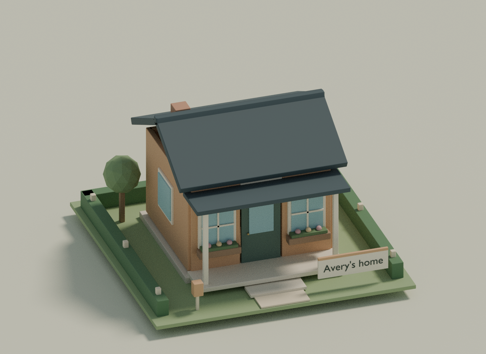

# Citymoney · The Waterfront Club

A Roblox property game set in a landscaped island neighborhood. Buy a lot and a **physical, furnished cottage** appears immediately—with its garden, porch, mailbox, and your name on the owner sign. Collect districts, upgrade into bigger homes, and walk through the properties you own.

**[Download the Waterfront game](https://github.com/evaluegame/Citymoney/raw/refs/heads/main/Citymoney-Waterfront.zip)** · **[Studio place file](https://github.com/evaluegame/Citymoney/blob/main/Citymoney-Waterfront.rbxlx)**

The ready-to-open downloads are at the repository root. On GitHub's file page, click **Download raw file** (the download-arrow button). For the full repository, use **Code → Download ZIP**.



*A render of the same house geometry used by the game. This is a model preview, not a Roblox Studio screenshot.*

## Open and play

1. Use **Roblox Studio on Windows or macOS**. Install it from [Roblox Creator Hub](https://create.roblox.com/) and sign in.
2. Download and extract **Citymoney-Waterfront.zip**.
3. In Studio, choose **File → Open from File** (Ctrl+O / Cmd+O) and open **Citymoney/build/Citymoney.rbxlx**.
4. Press **Play (F5)**, then click **Start the neighborhood**. Solo games automatically include City Bot.
5. For friends, use Studio's **Server & Clients** test with 2–6 players. The first connected player hosts the table. Late arrivals join the next match.

The editor includes the neighborhood preview; menus appear during Play. The place is self-contained: no plugins, paid assets, API keys, or HTTP access are needed. Use **File → Publish to Roblox** in your own account when you want to release it, with server capacity set to **6**.

## What changed

- A larger waterfront neighborhood with park paths, a tiered fountain, flower gardens, trees, street lamps, jetties, and boats.
- Warm afternoon lighting, soft shadows, a cream-and-sage HUD, compact player cards, and property cards with live 3D home previews.
- The HUD fits the actual safe screen area. Roblox chat and player-list overlays are hidden during play, and the action bar stays inside the window.
- Every purchase immediately builds a house. Homes have real doorway openings, owner signs, mailboxes, furniture, and landscaped plots.
- Upgrades change the architecture: cottage → townhouse → garden villa → grand villa, with balconies, rooftop pergolas, upstairs bedrooms, and staircases.
- Actual player avatars move around the board. You can switch to walking mode at your own properties, open the front door, and explore.
- Free exterior repainting during your turn, close-up camera views, a day/night switch, a home portfolio, confirmation before selling, and end-of-match standings.

## Controls

| Action | Control |
| --- | --- |
| Roll / buy / end turn | Bottom action button; **R** rolls; **Space** performs the current action while in board view |
| Inspect a property | Click/tap its plot or house, or open **Your homes** |
| Buy a home | Land on an unowned property and choose **Buy cottage** |
| Upgrade / repaint / sell | Select a home you own during your turn; upgrades require its district pair |
| Visit a home | Select your home and click **Walk through your home**, including during another player's turn |
| Walk and look around | Normal Roblox WASD / touch controls and camera in walking mode |
| Open/close the front door | Use the door prompt, **E** on keyboard; only the owner operates it |
| Return to the board | **B** or **Back to board**; rolling or ending your turn also returns you |
| View a home's architecture | **Close-up** on its property card |
| Board camera | Overview, rotate arrows, + / −, mouse wheel |
| Day/night lighting | **Golden hour / Night stroll** in the desktop header |

Visits do not change your token's game position, money, or turn. The match continues while you explore. Selling a visited home returns you to the board. Repainting or upgrading while visiting puts you safely back on its front path.

## Rules

Start with **$1,500** and roll two six-sided dice. Passing or landing on City Gate pays **$200**. Doubles do not grant another turn. Buy unowned properties on arrival, or pass. Buying includes the level-0 cottage; you do not need a district pair for that first house.

Visitors to another resident's property pay rent. Own both deeds in a colored district to double their base rent and unlock upgrades. Upgraded rent is **3× / 6× / 10×** the original base rent. Each upgrade charges the deed's build cost. Repainting cycles four exterior palettes for free during your turn and does not change rent.

City News draws a random event. City Tax costs **$120**. Detention skips your next move; merely visiting detention is harmless. Central Park is a rest stop. Each decision allows **55 seconds**, then the server automatically rolls, passes on a purchase, or ends the turn. Property visits and repainting do not extend that timer or delay the bot.

Sell a deed for half its purchase and upgrade costs. Cash shortfalls automatically sell deeds in board order to cover a bill; insolvency eliminates the resident. Sold, abandoned, or repossessed homes are removed from the physical neighborhood. A departing owner's deeds return to the city. Existing upgraded rent remains if a district partner is sold, but further upgrades require completing the pair again.

The last resident standing wins. At **120 total turns**, the highest cash plus full property/upgrade cost wins; ties go to the earlier seat. The host can start another game. All money and progress belong to the current match; persistent profiles, player-to-player trading, and auctions are not included.

## Development

Use the existing checkout; cloud tasks are already isolated and do not require a Git worktree.

```bash
cd /workspace/Citymoney
python3 scripts/setup.py
bash scripts/test.sh
bash scripts/build.sh
```

The Linux x86_64 bootstrap installs **Rojo 7.7.1** and **Luau 0.727** into ignored `.tools/` using official release archives and verified publisher SHA-256 digests. It can be rerun safely. No system package changes are needed.

`build.sh` produces **build/Citymoney.rbxlx** and **build/Citymoney-Studio.zip**. The root-level download files are release copies, refreshed separately when publishing. Builds leave those tracked release copies alone.

For source editing on the same machine as Studio, use `rojo serve default.project.json --address 127.0.0.1 --port 34872` (or `.tools/rojo` here) and the [official Rojo Studio plugin](https://rojo.space/docs/v7/getting-started/installation/). A source-only Rojo build also works; the server creates the neighborhood when Play starts. The cloud CLI cannot run Roblox Studio.

| Path | Purpose |
| --- | --- |
| `src/shared/Architecture.lua` | Physical parcels, four home levels, interiors, rotations, and porch arrival positions |
| `src/shared/Board.lua` | Neighborhood, park, landscaping, and closed board route |
| `src/shared/Scene.lua` | Roblox model and 3D-preview construction from the shared geometry |
| `src/shared/Layout.lua` | Screen-safe desktop and portrait HUD layout |
| `src/shared/Engine.lua` | Server-owned turns, buying, rent, upgrades, repainting, and visit authorization |
| `src/shared/Config.lua` | Economy, district colors, events, and match settings |
| `src/server/World.lua` | House lifecycle, animated avatars, visits, and interactive doors |
| `src/server/init.server.lua` | Lobby, validated remotes, bot, and turn deadlines |
| `src/client/init.client.lua` | HUD, deed previews, overview/close-up/walking cameras, and input |

The checks include **35 engine tests with 200 complete simulated matches**, board-path/scene checks, all 16 home plots at all four levels, doorway/furniture/stair/rotation checks, and responsive-layout cases including the reported 1192×642 safe area. Shared modules are analyzed, all game scripts compile, and the built place is checked against the current source, all tile labels, camera reference, and serialized geometry transforms.

`scripts/render_preview.py` optionally renders exported real scene geometry with Blender. These renders are **geometry previews, not Roblox Studio screenshots**. Blender is not needed to play or build the game.

Actual rendering, avatar movement, input, door prompts, and multiplayer replication still need a Studio playtest. Automated cloud checks cannot verify those engine behaviors.
